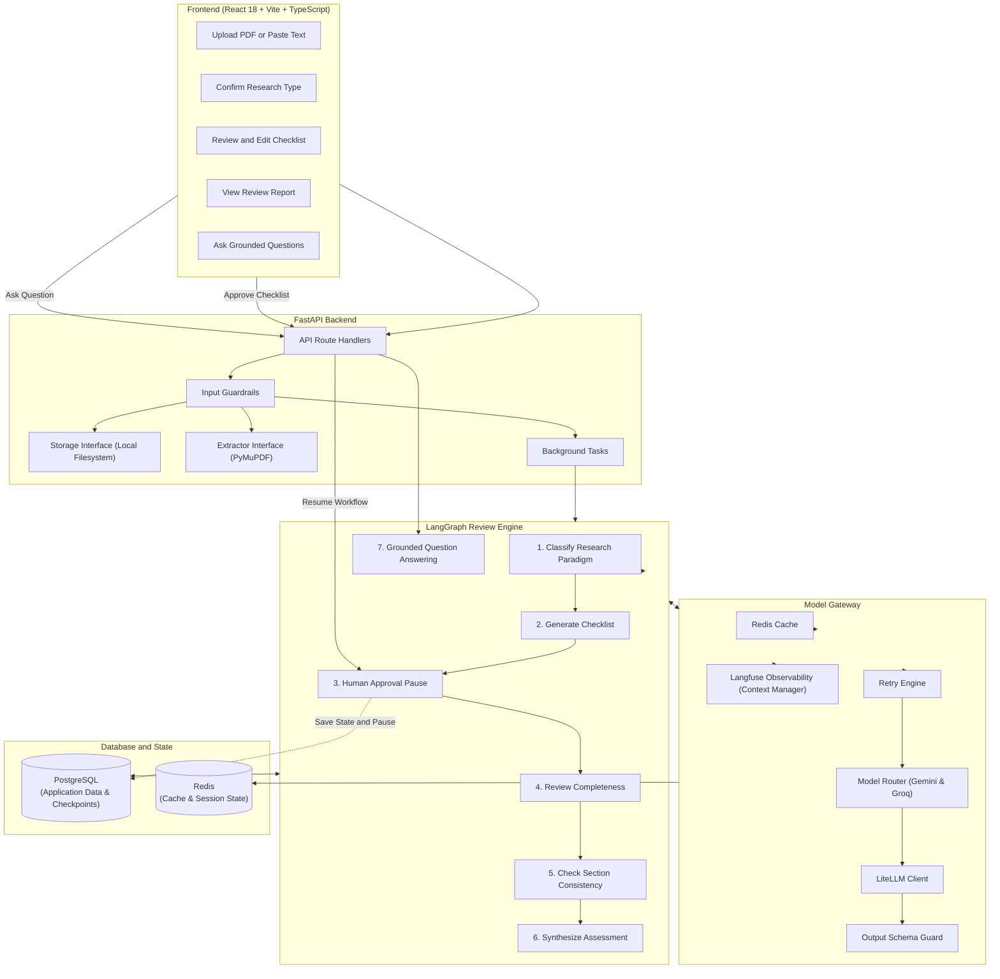
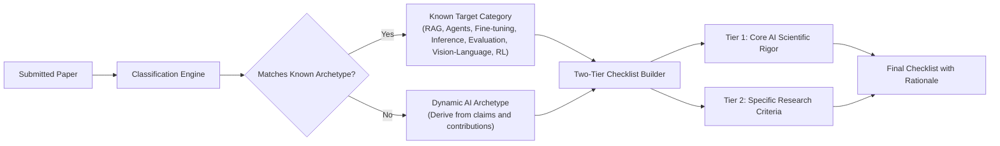

# Architecture Design Plan — ReproCheck

## 1. Goal Description

ReproCheck is an AI tool for reviewing computer science research papers.
The tool checks whether an AI paper describes its research and experiments clearly.
It detects missing information and incomplete descriptions.
It identifies differences between methodology, experiment, and results sections.
It gives verbatim quotes from the submitted paper as evidence for every finding.

This document describes the complete system design.
It follows the requirements in [PROJECT.md](file:///media/sage/Data/Documents/reprocheck/PROJECT.md) and [ARCHITECTURE.md](file:///media/sage/Data/Documents/reprocheck/ARCHITECTURE.md).
It follows the engineering rules in [AGENTS.md](file:///media/sage/Data/Documents/reprocheck/AGENTS.md).

---

## 2. Modularity and Upgradability

The architecture uses simple interfaces to keep components modular:

1. **Storage Interface**:
   The application accesses files through a storage interface.
   The initial version uses local disk storage.
   Developers can add cloud object storage later without changing application code.
2. **Document Extractor Interface**:
   The application extracts text through an extractor interface.
   The initial version uses PyMuPDF.
   Developers can add other extraction tools later through the same interface.
3. **Model Gateway**:
   The application calls language models through LiteLLM.
   Environment variables configure model names.
   The initial version uses free models from Google Gemini and Groq.
   Developers can change model names without changing application code.
4. **Workflow Nodes**:
   LangGraph coordinates the review steps.
   Each step runs in an independent node function.
   Developers can add new review checks as new nodes.
5. **Session Identity**:
   The database stores a nullable `user_id` on each session.
   The initial version identifies sessions by session ID.
   Developers can add authentication later without changing the database schema.

---

## 3. System Architecture



---

## 4. Component Design

### 4.1 Extensible Research Type Taxonomy

The system supports standard focus areas and novel AI papers:



- **Tier 1 (Universal Scientific Rigor)**: Applies to all AI papers:
  - Dataset source, splits, and pre-processing steps.
  - Compute hardware, runtime, and software framework versions.
  - Hyperparameters, optimization algorithm, and tuning search budget.
  - Baseline selection fairness, test conditions, and random seeds.
- **Tier 2 (Specific Research Criteria)**:
  - For known categories: Applies specific best-practice criteria.
  - For novel categories: The model derives 4 to 6 criteria from the claimed contributions.

### 4.2 Model Gateway and Free Tier Models

The gateway uses free models from Google Gemini and Groq:

- **Primary Model**: `gemini/gemini-1.5-flash` or `groq/llama-3.3-70b-versatile`.
- **Fallback Model**: `groq/llama-3.1-8b-instant`.
- **Retry Policy**: 3 attempts with exponential backoff on rate limits (429) and server errors (5xx).
- **Fallback Action**: If the primary model fails or reaches a rate limit, the gateway immediately calls the fallback model.
- **Cache**: Redis caches model responses using a SHA-256 hash of the prompt and parameters.

### 4.3 Observability with Langfuse Context Manager

The application uses the Langfuse context manager pattern directly.
It does not use generic callback handlers.
This pattern gives full control over span timing, metadata, and data privacy.

```python
from langfuse import get_client, propagate_attributes

langfuse = get_client()

# Root span for the review pipeline
with langfuse.start_as_current_observation(
    as_type="span",
    name="paper-review-pipeline",
    input={"session_id": session_id, "input_type": input_type},
) as root_span:
    with propagate_attributes(session_id=session_id):
        # Step observation for checklist generation
        with langfuse.start_as_current_observation(
            as_type="generation",
            name="generate-checklist",
            model=model_name,
            input={"research_type": research_type},
        ) as generation:
            # Mask raw paper text to protect user content
            generation.update(
                output={"checklist_count": len(criteria)},
                usage={"total_tokens": usage.total_tokens},
            )

    root_span.update(output={"status": "COMPLETED"})
```

### 4.4 Human-in-the-Loop Review Workflow

1. The user submits a paper.
2. The system extracts sections and determines the research type.
3. The system generates a candidate checklist with rationales.
4. LangGraph saves the state to PostgreSQL and pauses execution.
5. The frontend displays the checklist.
6. The user adds, edits, or removes criteria.
7. The user clicks "Approve Checklist".
8. The backend resumes the LangGraph workflow from the saved checkpoint.
9. The workflow completes the review using the approved criteria.

### 4.5 Grounded Question Answering

The question answering feature uses only:
- The extracted methodology text.
- The experiment and results text (if available).
- The approved checklist criteria and rationales.
- The generated review report and supporting evidence quotes.

If the user asks an unrelated question, the system returns a polite refusal.

---

## 5. Module Structure

```
backend/
├── alembic/                      # Database migrations
├── app/
│   ├── main.py                   # FastAPI app entry point
│   ├── config.py                 # Configuration settings
│   ├── api/                      # Route handlers
│   │   ├── deps.py               # Dependency injection
│   │   ├── sessions.py           # Session routes
│   │   ├── checklists.py         # Checklist routes
│   │   ├── reviews.py            # Review routes
│   │   └── qna.py                # Question answering routes
│   ├── core/                     # Core infrastructure
│   │   ├── database.py           # SQLAlchemy async database session
│   │   ├── redis.py              # Redis client
│   │   ├── guardrails.py         # File and text guardrails
│   │   ├── llm_gateway.py        # Model calling, retries, and fallbacks
│   │   └── observability.py      # Langfuse context manager functions
│   ├── interfaces/               # Abstract component interfaces
│   │   ├── storage.py            # Storage interface
│   │   └── extractor.py          # Document extractor interface
│   ├── services/                 # Concrete service implementations
│   │   ├── local_storage.py      # Local disk storage service
│   │   ├── pymupdf_extractor.py  # PyMuPDF extractor service
│   │   └── session_service.py    # Session coordination
│   ├── models/                   # SQLAlchemy database models
│   │   ├── session.py            # ReviewSession and Paper models
│   │   ├── checklist.py          # ChecklistItem model
│   │   ├── finding.py            # ReviewFinding and EvidenceReference models
│   │   └── qna.py                # QnAMessage model
│   ├── schemas/                  # Pydantic schemas
│   └── workflows/                # LangGraph workflow
│       ├── state.py              # ReviewGraphState definition
│       ├── graph.py              # Graph builder and transitions
│       ├── nodes/                # Individual workflow nodes
│       │   ├── classify.py
│       │   ├── checklist.py
│       │   ├── review.py
│       │   ├── consistency.py
│       │   ├── assessment.py
│       │   └── qna.py
│       └── prompts/              # Model prompt templates
frontend/
├── src/
│   ├── main.tsx                  # React entry point
│   ├── App.tsx                   # Main component
│   ├── api/                      # Backend API client
│   ├── components/
│   │   ├── upload/               # File upload and text paste components
│   │   ├── classification/       # Research type selector
│   │   ├── checklist/            # Checklist review and edit table
│   │   ├── report/               # Findings and evidence cards
│   │   └── qna/                  # Question answering chat component
│   ├── types/                    # TypeScript data definitions
│   └── hooks/                    # React state hooks
```

---

## 6. Multi-Level DeepEval Test Suite

The test suite tests each workflow stage separately:

- `tests/evaluation/test_01_classification.py`: Tests accuracy of research type classification.
- `tests/evaluation/test_02_checklist_quality.py`: Tests checklist relevance, clarity, and non-redundancy.
- `tests/evaluation/test_03_review_completeness.py`: Tests detection of missing methodology items.
- `tests/evaluation/test_04_consistency_check.py`: Tests detection of section differences.
- `tests/evaluation/test_05_evidence_grounding.py`: Tests that all finding quotes exist in the paper text.
- `tests/evaluation/test_06_qna_faithfulness.py`: Tests question answering accuracy and refusal of out-of-scope questions.

---

## 7. Verification Plan

### 7.1 Automated Tests
Run unit tests for isolated logic:
```bash
pytest tests/unit/
```
Run integration tests for the API and workflow:
```bash
pytest tests/integration/
```
Run evaluation tests for model outputs:
```bash
pytest tests/evaluation/
```

### 7.2 Manual Verification
1. Upload a research paper with missing hyperparameter details.
2. Verify that the system extracts sections correctly.
3. Verify that the system assigns the expected research type.
4. Edit the checklist: add one criterion, edit one criterion, and delete one criterion.
5. Approve the checklist and verify that the review continues.
6. Verify that the report shows exact quotes from the paper for each finding.
7. Ask questions about the paper in the chat.
8. Verify that answers cite the paper text and refuse out-of-scope questions.
